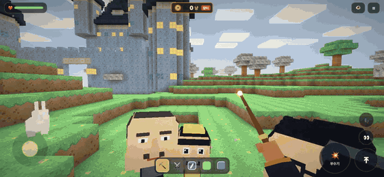
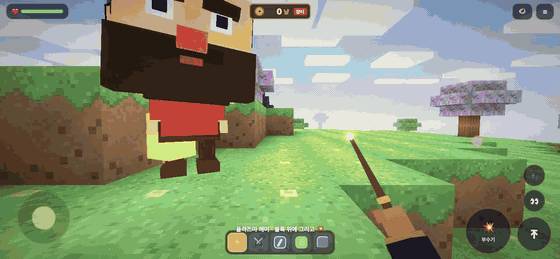
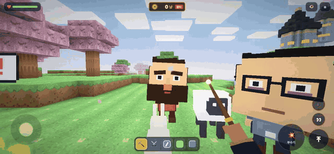

# Voxel Valley

블록으로 된 계곡을 **그려서 부수고, 땅굴을 파고, 내 방 사진으로 집을 짓는** 복셀 샌드박스예요.

### ▶ [지금 바로 웹에서 하기](https://damho0514.github.io/voxel-valley/play/)

설치 없이 휴대폰, 태블릿, 컴퓨터 브라우저에서 바로 돼요. 휴대폰은 가로로 돌려서 하면 넓게 보여요.

### 📱 앱으로 받기

| 기기 | 방법 |
|---|---|
| **안드로이드** | [**VoxelValley.apk 내려받기**](https://github.com/damho0514/voxel-valley/releases/latest/download/VoxelValley.apk) → 파일을 열고 *출처를 알 수 없는 앱 설치*를 허용하면 설치돼요. 예전 버전(1.2 이하)이 깔려 있으면 서명이 바뀌어서 **지우고 새로 설치**해야 해요. |
| **아이폰 · 아이패드** | Safari로 [웹 게임](https://damho0514.github.io/voxel-valley/play/)을 열고 **공유 → 홈 화면에 추가**. 앱처럼 아이콘이 생기고 전체 화면으로 열려요. |
| **컴퓨터** | [웹 게임](https://damho0514.github.io/voxel-valley/play/)을 열면 키보드와 마우스로 할 수 있어요 (WASD 이동, 마우스로 시점). |

안내 페이지: https://damho0514.github.io/voxel-valley/app/

## 🎬 플레이 영상

실제 게임 화면을 자동으로 녹화한 영상이에요 (소리는 녹음되지 않았어요). 아래 움짤은 1.5배속이고, 원본 영상 링크는 각 항목에 있어요.

### 1. 내 공간 → 게임 속 내 집

내 방이나 카페 사진, 스크린샷을 ☰ → **내 공간 제출**로 올리면 제출 도장이 찍히고 스캔하는 연출이 나와요. 사진의 벽·바닥·천장·포인트 색과 분위기를 읽어 감성 점수를 매기고, **여기에 짓기**를 누르면 그 색감으로 집이 한 단계씩 지어져요. 뒷벽에는 사진이 블록 벽화로, 옆벽에는 진짜 사진 액자로 걸려요.



[원본 영상 (34초, mp4)](https://damho0514.github.io/voxel-valley/media/house.mp4)

### 2. 땅굴 파기 → 보물 → 꿀알바 편의점

블록 위에 손가락으로 그리고 💥를 누르면 한 번에 부서지면서 엽전(냥)이 튀어요. 동그라미로 묶으면 **싹쓸이 ×2**, 이어서 부수면 *좋다! 얼쑤! 지화자!* 추임새가 붙어요. 깊이 팔수록 보석(금덩이·홍옥·청옥·비취·금강석)과 옛 궤짝 **반닫이**가 나와요. 반닫이는 **쪽박부터 초대박**까지 등급이 있어요. 땅 밑 **다섯 칸**까지 파 내려가면 시공간이 빨려 들어가 **꿀알바 편의점**으로 이동해요.



[원본 영상 (35초, mp4)](https://damho0514.github.io/voxel-valley/media/dig.mp4)

### 3. 동네 사람들과 대화

계곡에는 털보 아저씨, 안경 선배, 잼민이, 폰좀비, 바코드 부장님이 돌아다녀요. 탭하면 멈춰 서서 나를 보고 대화창이 열리고, 사람마다 자기 말투로 소리 내어 대답해요. 추천 문장을 누르거나 직접 써도 되고, 🎤로 말해도 돼요.



[원본 영상 (25초, mp4)](https://damho0514.github.io/voxel-valley/media/talk.mp4)

## 그 밖에

- **어두운 밤의 세계:** 계곡, 미래 도시, 우주, 꿀알바 거리 모두 달빛만 비치는 어두운 밤이에요.
- **차원 문:** 미래 도시(날아다니는 자동차)와 무중력 우주(블랙홀), 땅 밑 꿀알바 편의점.
- **마법 양탄자:** 어느 맵에서나 하늘을 날아요. 1인칭과 3인칭을 바꿀 수 있어요.
- **용과 전투:** 용을 불러 지형을 날리고, 용암과 체력, 길들일 수 있는 동물 펫.
- **장터:** 모은 냥으로 더 센 지팡이와 강화를 사요.
- **친구와 같이 하기:** ☰ → 친구 초대로 링크를 보내면 같은 월드에 바로 들어와요. 서버는 Cloudflare Worker예요(`server/`).

## 실행

```bash
npm install
npx expo start --web      # 브라우저
npx expo prebuild --platform ios   # 아이폰용 네이티브 빌드 (Xcode)
```

## 조작 방식 (기기별)

플레이 화면은 기기를 알아보고 조작 방식을 고릅니다. 쓰는 입력이 바뀌면(터치 ↔ 마우스·키보드) 그에 맞춰 바로 바뀝니다.

| 기기 | 조작 |
|---|---|
| 앱 (iOS · Android) | 터치: 왼쪽 아래 조이스틱, 화면에 그려서 표시 → 💥 버튼, 🧞 · ▲▼ · 👁 버튼 |
| 휴대폰 · 태블릿 브라우저 | 앱과 같은 터치 조작 |
| 컴퓨터 브라우저 | 키보드 + 마우스 (아래 표) |

컴퓨터 브라우저에서는 게임 화면을 클릭하면 마우스가 고정되고 움직이는 만큼 시점이 돕니다. 감도는 1픽셀에 약 0.13°로 맞춰 두어 따로 설정하지 않아도 됩니다. 마우스 고정을 막는 브라우저에서는 고정 없이 마우스를 움직이는 대로 시점이 돌고, Esc를 누르면 풀립니다.

키 배치는 넥슨 서든어택의 기본 조작([공식 가이드: 게임 조작법](https://guide.sa.nexon.com/guide/25))을 따랐습니다. 이 게임에 같은 기능이 있는 키만 같은 자리에 두었고, 없는 기능(무기 버리기, 채팅, 라디오 메시지 등)은 넣지 않았습니다.

| 키 · 버튼 | 동작 | 서든어택 |
|---|---|---|
| 마우스 이동 | 둘러보기 | 같음 |
| W A S D · 방향키 | 걷기 · 날기 | 같음 |
| Space | 점프 · 상승 | 같음 |
| Shift | 천천히 걷기 (발소리 없음, 자동 점프 꺼짐) · 날 때 하강 | 걷기 |
| Ctrl · C | 앉기 (시점이 낮아지고 느리고 조용함) · 날 때 하강 | 앉기 (C는 이 게임만) |
| 좌클릭 | 지팡이: 누른 채 쓸어서 표시 · 블록: 캐기 · 검: 베기 | 공격 |
| 우클릭 | 지팡이: 💥 부수기 · 블록: 놓기 | 보조 공격 |
| 1 / 2 / 3 | 지팡이 / 블록 (다시 누르면 유리 → 잔디 → 메탈) / 에너지 검 | 주무기 / 보조무기 / 근접무기 |
| 4 / 5 | 🐉 용 소환 / 💥 표시한 블록 터뜨리기 | 보조장비 / 폭탄 |
| Q · 휠 | 이전 무기 · 무기 넘기기 | 이전 무기 |
| R | 재장전: 지팡이 표시 비우기 | 재장전 |
| Tab (누르고 있기) | 함께 있는 사람 | 상황판 |
| [ · ] | 마우스 속도 −15% / +15% (이번 판만) | 민감도 감소 / 상승 |
| F | 🧞 양탄자 | 특수기능 |
| B / G / X / H · F1 / V · F5 | 상점 / 용 소환 / 표시 지우기 / 도움말 / 1인칭 ↔ 3인칭 | (이 게임만) |
| Esc | 마우스 풀기 (메뉴·상점을 누를 수 있게) | |

화면을 클릭하면 **전체 화면**으로 바뀌고 마우스가 고정됩니다 (Esc 한 번이면 둘 다 풀리고 "클릭해서 계속하기"가 나옵니다). 게임 중에는 브라우저 단축키가 게임 키를 가로채지 않습니다: Ctrl을 누른 채(앉기) S·D·F·P·R 등을 눌러도 저장·북마크·찾기가 뜨지 않고, 크롬·엣지 전체 화면에서는 Ctrl+W·Ctrl+T도 게임 키가 됩니다(키보드 잠금). 상점은 W·D 바로 옆이라 실수로 열리던 E 대신 B입니다. 맥에서 Ctrl+Space가 입력 소스 전환(한/영)으로 설정돼 있으면 운영체제가 먼저 가져갈 수 있으니, 그때는 앉은 채 점프를 C+Space로 하세요.

**에어팟 · 이어폰 버튼:** 아래 "에어팟을 마우스처럼"을 보세요.

### 🎧 에어팟을 마우스처럼 (맥)

카메라도 몸동작도 아니고, 에어팟 자체가 마우스입니다: **커서 = 에어팟 안의 동작 센서**, **클릭 · 휠 = 에어팟 누르기**.

| 에어팟 | 마우스 |
|---|---|
| 에어팟을 돌리기 (귀에 낀 채 고개, 또는 손에 들고) | 커서(시점) 이동 |
| 한 번 누르기 | 클릭: 지팡이는 조준한 블록 💥 (표시해 둔 게 있으면 그것) · 검은 베기 · 블록은 놓기 |
| 두 번 누르기 | 휠 ↓ (다음 무기) |
| 세 번 누르기 | 휠 ↑ (이전 무기) |

브라우저는 에어팟의 동작 센서를 읽을 수 없어서, 맥 메뉴 막대 앱 `tools/airpods-bridge`가 대신 읽어 게임에 보냅니다 (`CMHeadphoneMotionManager`, macOS 14 이상, 동작 센서가 있는 에어팟: AirPods 3세대 이상 · Pro · Max). 브리지는 어떤 에어팟인지(맥의 소리 출력 이름, 블루투스인지)와 **어느 쪽 이어버드의 센서가 커서를 움직이는지(왼쪽 · 오른쪽)**를 구분해 알려 주고, 게임 왼쪽 위에 "🎧 ○○의 AirPods · 오른쪽 이어버드 · 에어팟 마우스 켜짐"으로 보입니다. 에어팟을 누를 때마다 그 아래에 "🖱 클릭 / 휠 ↓ / 휠 ↑"가 잠깐 떠서 게임이 받은 입력을 확인할 수 있습니다. 클릭·휠은 브리지 없이도 됩니다(게임 음악이 나오는 동안 브라우저가 에어팟 버튼을 게임으로 보냅니다).

1. 빌드: `tools/airpods-bridge/build.sh` → `open "tools/airpods-bridge/build/VV AirPods.app"` (메뉴 막대에 🎧가 생깁니다)
2. 에어팟을 맥에 연결합니다. 맥의 소리 출력이 에어팟이어야 센서 값이 들어옵니다. 처음 한 번 "동작 및 피트니스" 권한을 허용합니다. 손에 들고 쓸 때 센서가 멈추면 블루투스 설정에서 에어팟의 "자동 귀 감지"를 끄세요.
3. 컴퓨터 브라우저에서 게임을 열고 화면을 클릭합니다 (전체 화면).

- 에어팟을 조금 돌리면 시점이 2.6배(위아래 2배) 따라 돌고, 17° 넘게 돌리고 있으면 되돌릴 때까지 계속 돕니다.
- K: 에어팟 마우스 끄기 / 켜기 (켤 때 지금 방향을 정면으로 잡습니다). 진짜 마우스도 그대로 함께 쓸 수 있습니다.
- 브리지는 이 맥 안(`ws://127.0.0.1:47800`)에서만 열리고, localhost와 `https://damho0514.github.io` 페이지만 접속할 수 있습니다.
- 테스트: `"…/VV AirPods.app/Contents/MacOS/AirPodsBridge" --fake` 는 에어팟 없이 가짜 머리 움직임을 보냅니다.

### 웹과 앱을 따로 개발하기

입력 코드는 `src/input/`에 플랫폼별 파일로 나뉘어 있습니다. Metro가 웹 빌드에서는 `*.web.ts`를, 앱 빌드에서는 같은 이름의 `*.ts`를 고르므로 한쪽을 고쳐도 다른 쪽에는 영향이 없습니다.

| 파일 | 앱 (iOS · Android) | 웹 |
|---|---|---|
| `device.ts` / `device.web.ts` | 항상 터치 | 포인터 종류 · UA · 실제 입력으로 터치 / 데스크톱 판별 |
| `desktop.ts` / `desktop.web.ts` | 아무 동작 없음 | 키보드 · 마우스 · 포인터 고정 |

- 키보드·마우스로 하는 동작은 `DesktopActions`(`src/input/desktop.ts`)로 정의되고, 각 동작이 게임에서 하는 일은 `PlayScreen.tsx`의 `deskActions`에서 연결합니다.
- 컴퓨터 전용 화면 요소는 `src/ui/desktopHud.tsx`에 있습니다 (클릭해서 플레이 안내, 키 안내, 💥 우클릭 안내).
- 앱 전용 화면 요소(조이스틱, 버튼)는 `src/ui/controls.tsx`와 `src/ui/hud.tsx`에 있습니다.

## 🪙 보상 연출 (장터·풍물 모티브)

이모지 없이 직접 그린 모양과 오방색으로 통일했어요 (`src/ui/korea.tsx`: 엽전, 낙관 도장, 한지 띠지, 복주머니).

- 화폐는 **냥**, 동전은 **엽전**. 부수면 엽전이 돈주머니로 튀어 들어가요.
- 이어서 부수면 콤보 단계마다 **추임새** 도장: 좋다! → 얼쑤! → 잘한다! → 얼씨구! … → 지화자 좋다!
- 💥 부수기 결과: 한지 띠지 + 낙관(得 / 싹쓸이는 倍) — "와르르 32개 +128냥".
- 3% 행운: **복주머니**가 떨어져 터지며 엽전과 오방색 종이가 쏟아져요 ("복 터졌다!").
- 보물상자 → **반닫이**: 장구 소리에 들썩이다 앞판이 열리고, 등급 도장 **쪽박 · 소박 · 중박 · 대박 · 초대박**.
- 보석: 금덩이 · 홍옥 · 청옥 · 비취 · 금강석. 룬 → **부적 돌**, 효과는 재물운 · 날다람쥐 · 축지법 · 기운 충전 · 천리안 · 풍악을 울려라 · 보약 한 첩.
- 소리: `python3 tools/gen_sounds_korea.py` (엽전 짤랑, 장구, 꽹과리+징, 풍경 …). `gen_sounds.py money/treasure`를 다시 돌리면 예전 소리로 덮이니, 그 뒤엔 이 스크립트를 한 번 더 돌려 주세요.

## 📸 내 공간 제출 (사진 → 게임 속 집)

☰ 메뉴 → **내 공간 제출**. 카메라로 찍거나 사진·스크린샷을 고르면:

1. 폴라로이드가 떨어지고 "제출 완료" 도장 → 스캐너가 훑으며 사진이 블록으로 바뀌는 연출
2. 결과 카드: 벽·바닥·천장·포인트 색, 분위기 태그, 감성 점수와 등급(S/A/B)
3. **여기에 짓기** → 바라보는 쪽에 방이 한 단계씩 지어짐 (바닥 → 벽 → 천장 → 뒷벽 사진 벽화 → 가구 → 조명)

- 분석: `src/game/photoRoom.ts` (k-means 12색, 위/가운데/아래 영역 → 천장/벽/바닥, 밝기·웜톤·채도·초록·하늘 비율, 15×7 벽화). 순수 함수.
- 사진 색 블록 12종(`Block.Photo0..11`)은 마지막으로 제출한 사진 색으로 아틀라스 타일을 다시 칠해요 (`setPhotoTiles`).
- 사진 불러오기: 앱은 `expo-image-picker` + `expo-image-manipulator`(192px로 축소) + `jpeg-js`, 웹은 canvas (`src/photo/capture*.ts`).
- 진짜 사진 액자(`VoxelRenderer.setPhotoFrame`)와 색은 월드별로 저장(`src/photo/store.ts`)돼서 다시 들어와도 그대로예요.
- 차원문·바닥돌과 겹치면 왼쪽/오른쪽/뒤로 방향을 바꿔 짓고, 다 막혀 있으면 안내만 해요.
- 친구와 같은 방(온라인)에서는 사진 색을 서버가 아는 가장 가까운 기본 블록으로 바꿔 지어요 (모두에게 같은 방). 액자는 내 기기에만 보여요.
- 네이티브 빌드는 새 모듈 때문에 `npx expo prebuild --clean` 후 다시 빌드해야 해요. Expo Go와 웹은 바로 동작해요.

## 구조

| 경로 | 설명 |
|---|---|
| `src/game/` | 블록, 노이즈, 지형과 차원 생성, 메쉬, 물리, 봇과 동물, 저장 |
| `src/render/` | three.js 렌더러, 절차적 텍스처, 하늘, 효과, 용, 블랙홀 |
| `src/audio/sound.ts` | 효과음과 배경음악 재생 |
| `src/screens/PlayScreen.tsx` | 게임 루프와 HUD |
| `src/ui/controls.tsx` | 조이스틱과 터치 패드 |
| `server/` | 멀티플레이 방 서버 (Cloudflare Durable Object) |
| `tools/` | 효과음, 음악, 아이콘을 만드는 생성 스크립트 |

## 독자 제작 기록

이 게임의 코드, 그림, 소리는 모두 이 저장소 안에서 직접 만들었어요. 다른 게임의 에셋, 코드, 이름은 쓰지 않았어요.

| 에셋 | 만드는 방법 |
|---|---|
| 블록 텍스처 | `src/render/textures.ts`가 코드로 생성해요. 이미지 파일은 없어요. |
| 효과음과 배경음악 (23개) | `tools/gen_sounds.py`가 사인파와 노이즈로 합성해요. 멜로디와 화음도 직접 만들었어요. |
| 앱 아이콘과 스플래시 | `tools/gen_icons.mjs`가 SVG 도형으로 그려요. 원본 SVG는 `tools/icons/`에 있어요. |
| 3D 모델 (용, 동물, 로봇, 자동차) | `src/render/`의 three.js 기본 도형으로 조립해요. |
| 블록과 생물 이름 | 직접 지은 이름이에요 (이끼, 흙, 점토 등). |

에셋을 다시 만들 때는 아래 명령을 써요.

```bash
python3 tools/gen_sounds.py
PLAYWRIGHT=<playwright 패키지 경로> node tools/gen_icons.mjs
```

이 프로젝트는 다른 게임 회사와 제휴하거나 승인을 받은 공식 제품이 아니에요.

## 오픈소스 라이선스

앱에 들어가는 주요 라이브러리는 모두 MIT 라이선스예요. three.js, React, React Native, Expo 모듈, react-native-gesture-handler, AsyncStorage가 여기에 해당해요. 스토어에 배포할 때는 각 라이브러리의 저작권 고지를 앱 안이나 함께 배포하는 문서에 넣어야 해요.

이 프로젝트의 코드·디자인·사운드·게임 규칙은 모두 저작권자(damho0514)의 소유이며 무단 복제·수정·배포·모방·역설계를 금지해요 (All rights reserved). 자세한 내용은 `LICENSE`를 보세요.
